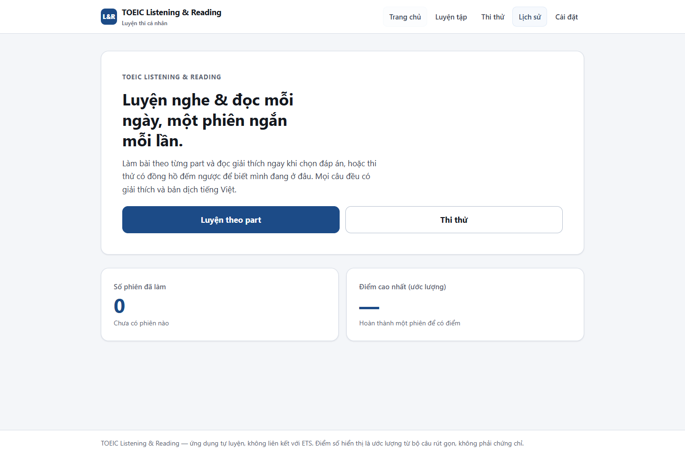

# TOEIC Listening & Reading — web luyện thi cá nhân

Ứng dụng web để **một người tự luyện TOEIC Listening & Reading hằng ngày**: luyện
theo từng part, thi thử có tính giờ, chấm điểm quy đổi thang 10–990, và xem giải
thích chi tiết bằng tiếng Việt cho từng câu.

Chạy hoàn toàn trong trình duyệt — không backend, không tài khoản, không phí, dữ liệu
nằm trong `localStorage` của chính máy bạn.



## Tính năng

| Tính năng | Mô tả |
|---|---|
| **Luyện theo part** | Chọn bất kỳ tổ hợp trong 7 part, chọn số câu mỗi part |
| **Thi thử** | Làm liền mạch có đồng hồ đếm ngược, hết giờ tự nộp, không lộ đáp án khi đang làm |
| **Chấm điểm** | Đúng/sai/bỏ trống, tách theo part và theo kỹ năng, quy đổi thang 10–990 |
| **Giải thích** | Mỗi câu có giải thích vì sao đáp án đúng và vì sao 3 đáp án kia sai, kèm bản dịch |
| **Xem lại** | Lọc câu sai để ôn lại sau mỗi phiên |
| **Lịch sử** | Lưu 100 phiên gần nhất, theo dõi điểm tiến bộ |
| **Tiếp tục** | Đóng tab giữa chừng vẫn làm tiếp được |
| **Bàn phím** | Phím `1`–`4` chọn A–D, `←` `→` chuyển câu |

## Công nghệ

- **React 19** + **TypeScript** (strict), build bằng **Vite 8**
- **Vitest** cho unit test phần logic thuần
- **oxlint** cho lint
- **Không thư viện UI, không thư viện router** — CSS viết tay, hash router tự viết
- Bộ kiểm thử thật trên **Chrome qua Chrome DevTools Protocol** (không Playwright/Puppeteer)

## Chạy dự án

```bash
npm install
npm run dev       # http://localhost:5173
```

Các lệnh khác:

```bash
npm run build       # type-check (tsc -b) + build production
npm run lint        # oxlint
npm test            # 195 unit test
npm run verify:core # 50 kiểm thử E2E thật trên Chrome qua CDP
npm run verify:ui   # 28 kiểm thử giao diện độc lập (do QA viết)
npm run shots       # chụp 10 ảnh màn hình vào docs/screenshots/
```

> `verify:core` / `verify:ui` / `shots` tự khởi động Vite + Chrome headless rồi dọn dẹp,
> không cần mở terminal riêng. Cần Chrome cài ở đường dẫn mặc định, hoặc đặt biến
> `CHROME_PATH`.

## Kiến trúc

```
src/
  types.ts            # Hợp đồng dữ liệu: Question, Stimulus, QuestionBank, PART_META
  testids.ts          # Hợp đồng data-testid + route hash (UI và test dùng chung)
  data/
    part1..part7.ts   # Ngân hàng 85 câu, chia theo part
    index.ts          # Ghép thành FULL_BANK
    content.test.ts   # 41 test kiểm cấu trúc nội dung
    answerKey.test.ts # Chốt cứng đáp án theo NỘI DUNG (chống đổi đáp án ngầm)
  lib/
    contract.ts       # Hợp đồng API engine (Session, SessionResult, EngineApi)
    session.ts        # Tạo/trả lời/nộp phiên — hàm thuần, bất biến
    scoring.ts        # Chấm điểm + quy đổi thang điểm
    storage.ts        # localStorage, không bao giờ throw
    time.ts           # formatClock
  ui/                 # 7 màn hình React + hash router
  styles/             # CSS viết tay
scripts/
  cdp.mjs             # Bộ khung test Chrome qua CDP (tự viết, không phụ thuộc ngoài)
  verify-core.mjs     # E2E: chọn part → làm bài → nộp → xem lại → lịch sử
  verify-ui.mjs       # QA: responsive, bàn phím, trạng thái rỗng, cài đặt
  screenshots.mjs     # Chụp 10 ảnh màn hình
docs/
  PLAN.md             # Kế hoạch thi công
  QA-REPORT.md        # Báo cáo kiểm thử độc lập
  screenshots/        # Ảnh chụp thật
```

**Nguyên tắc thiết kế:** toàn bộ quy tắc nghiệp vụ nằm trong `src/lib/` dưới dạng
**hàm thuần** — không import React, không chạm DOM — nên kiểm thử được độc lập ở môi
trường Node. UI chỉ là lớp mỏng hiển thị và gọi engine. Nhờ vậy điểm số chỉ có **một
nguồn sự thật** duy nhất, không thể lệch giữa hai nơi.

## Ngân hàng câu hỏi

85 câu tự viết, không lấy từ đề của ETS:

| Part | Số câu | Nội dung |
|---|---|---|
| 1 | 8 | Mô tả tranh (có ảnh SVG minh hoạ) |
| 2 | 12 | Hỏi – đáp (3 lựa chọn) |
| 3 | 12 | 4 hội thoại × 3 câu |
| 4 | 9 | 3 bài nói × 3 câu |
| 5 | 20 | Điền từ vào câu |
| 6 | 8 | 2 đoạn văn × 4 chỗ trống |
| 7 | 16 | 4 nhóm đọc hiểu, có 2 nhóm hai đoạn |

Phân bố đáp án đúng: A=23 (27%), B=22 (26%), C=22 (26%), D=18 (21%) — cân bằng để
không thể đoán đúng. Hai cơ chế chặn sai sót được cài thành test vĩnh viễn:
phân bố đáp án theo part, và độ dài phương án đúng không được trội bất thường.

## Quy tắc nghiệp vụ

| Quy tắc | Chi tiết |
|---|---|
| Điểm mỗi phần | `round(đúng / tổng của phần × 495)`, kẹp trong 5–495 |
| Tổng điểm | `nghe + đọc`, kẹp trong 10–990 |
| Độ tin cậy | Luôn gắn nhãn "ước lượng" khi làm < 200 câu |
| Bỏ trống | `answers[id] === null`, khác với "không có key" |
| Lịch sử | 100 bản ghi gần nhất |
| Thời lượng thi thử | `min(59:59, max(60s, số câu × 36s))` |
| Dữ liệu hỏng | `localStorage` hỏng → trả mặc định, **không làm sập app** |

## Kiểm thử

**Unit test** — 195 test, chạy ở Node, không cần trình duyệt:

```bash
npm test
```

**Kiểm thử thật trên Chrome** — mở Vite + Chrome headless, điều khiển qua CDP,
đọc DOM và `localStorage` thật:

```bash
npm run verify:core   # 50 điểm kiểm tra
npm run verify:ui     # 28 điểm kiểm tra
```

Không có kết quả nào trong `docs/QA-REPORT.md` được chép từ báo cáo của người khác —
QA tự chạy và tự đọc. Các giới hạn của việc kiểm thử (âm thanh, thiết bị thật, trình
duyệt khác) được ghi rõ ở mục cuối báo cáo.

## Giới hạn đã biết

- **Chưa có âm thanh thật.** Part 1–4 hiển thị và đọc được lời thoại (`audioScript`)
  bằng Web Speech API nếu trình duyệt hỗ trợ, nhưng chưa có file thu âm.
- **Điểm chỉ là ước lượng**, không phải điểm TOEIC thật. App ghi rõ điều này trên
  màn hình kết quả và trong footer.
- Ngân hàng 85 câu, chưa đủ 200 câu như đề thật.
- Chưa có chế độ "ôn câu sai" xuyên phiên và biểu đồ tiến bộ theo tuần.

## Ghi công

Dự án được lắp ghép bởi 1 lead + 4 vai trò làm song song: nội dung (`content`),
logic (`engine`), giao diện (`ui`), kiểm thử độc lập (`qa`). Kế hoạch thi công ở
[`docs/PLAN.md`](docs/PLAN.md), kết quả kiểm thử ở [`docs/QA-REPORT.md`](docs/QA-REPORT.md).
